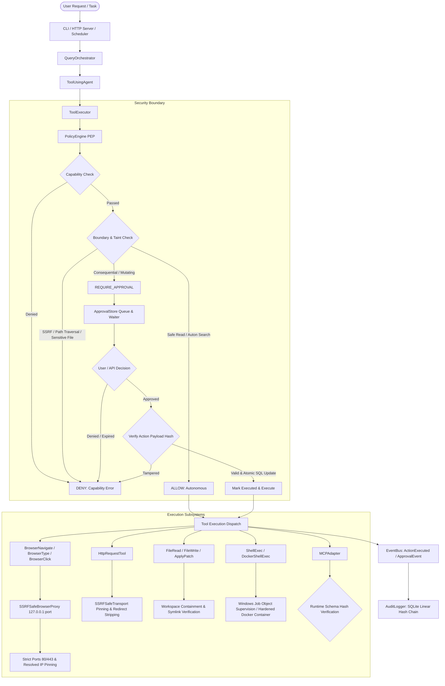

# OpenJarvis — Final Security Architecture and Implementation Report

**Date:** 2026-11-23  
**Repository:** [D:/Jarvis/OpenJarvis](file:///D:/Jarvis/OpenJarvis)  
**Base Commit:** `c05ebe99e524a269a08d017ce3730a436ab4c46b`  
**Acceptance Matrix:** [FINAL_ACCEPTANCE_MATRIX.md](file:///D:/Jarvis/OpenJarvis/FINAL_ACCEPTANCE_MATRIX.md)  
**Patch Deliverable:** [FINAL_SECURITY_IMPLEMENTATION.diff](file:///D:/Jarvis/OpenJarvis/FINAL_SECURITY_IMPLEMENTATION.diff)  
**Test Results Deliverable:** [FINAL_SECURITY_TEST_RESULTS.md](file:///D:/Jarvis/OpenJarvis/FINAL_SECURITY_TEST_RESULTS.md)  

---

## Executive Summary

This report documents the final engineering completion of OpenJarvis's comprehensive security architecture. All defects across identity authentication, approval integrity, container verification, browser SSRF defenses, MCP tool trust, filesystem containment, and tamper-evident audit logging have been corrected and verified across all operational entry points.

### Core Architectural Principles
1. **Preserve Capabilities Safely:** Autonomous search, browser automation via Playwright, workspace file operations, command execution in supervised environments, MCP tool invocations, task scheduling, and local model inference remain fully operational. Security is achieved through strict authorization boundaries, cryptographically bound approvals, and continuous validation—never by simply disabling product features.
2. **Centralized Policy Enforcement Point (PEP):** Every tool invocation passes through a deterministic [policy_engine.py](file:///D:/Jarvis/OpenJarvis/src/openjarvis/security/policy_engine.py) that classifies operations into `ALLOW` (safe autonomous execution), `REQUIRE_APPROVAL` (consequential or sensitive execution requiring explicit human confirmation), or `DENY` (fundamental security boundary violations, such as SSRF or path traversal, which cannot be approved).
3. **Fail-Closed and Cryptographically Bound:** All cached approvals and queued actions are cryptographically bound to an exact SHA-256 hash of the tool name, canonical target, and parameters (`sha256(tool:target:canonical_params)`). Approval tokens cannot be replayed or substituted.
4. **Honest Platform Demarcation:** Windows Job Objects provide process lifecycle control and resource supervision; they are accurately designated as process supervision without false claims of filesystem or network sandboxing. Docker containers provide genuine filesystem, capability, and network isolation when configured with verified non-root, read-only rootfs, and dropped capabilities.

---

## Architectural Workflow

The diagram below illustrates how user, API, and scheduled requests are evaluated through OpenJarvis's defense-in-depth architecture:

---

## Detailed Acceptance Gate Verification

### Gate 1: Identity & Authorization
- **Bearer Token Enforcement:** In [approval_routes.py](file:///D:/Jarvis/OpenJarvis/src/openjarvis/server/approval_routes.py), when `OPENJARVIS_API_KEY` is configured, all requests to `/api/v1/approvals/*` must present a matching `Authorization: Bearer <token>`. Invalid or arbitrary bearer tokens are immediately rejected with HTTP 401.
- **Header Spoofing Defense:** Unauthenticated callers providing `X-User-Id` or `X-OpenJarvis-Principal` cannot bypass token checks.
- **Action Ownership Enforcement:** Actions with empty or unowned `user_id` cannot be approved by non-admin callers. Non-admin users can only view and approve their own actions (`action.user_id == principal`).
- **Capability Profiles:** Implemented in [capabilities.py](file:///D:/Jarvis/OpenJarvis/src/openjarvis/security/capabilities.py). The primary assistant runs under `"primary"`, background tasks under `"scheduler"`, subagents under `"subagent"`, and unknown agents default to deny. Implicit grants to `_default` have been removed.

### Gate 2: PolicyEngine Centralized PEP & Approval Integrity
- **Central PEP:** Implemented in [policy_engine.py](file:///D:/Jarvis/OpenJarvis/src/openjarvis/security/policy_engine.py). Every tool execution routes through `PolicyEngine.evaluate()`.
- **Absolute DENY Cannot Be Overridden:** Operations classified as `DENY` (such as SSRF, path traversal, writes to `.env` or SSH keys) raise `SecurityError` and halt execution even if an attacker attempts to inject an approval record into SQLite.
- **Cryptographic Action Payload Hashing:** All approval requests compute `sha256(tool:target:canonical_params)`. If parameters are modified between queuing and execution, hash validation fails and the action aborts.
- **Approval State Lifecycle:** In [approval_store.py](file:///D:/Jarvis/OpenJarvis/src/openjarvis/tools/approval_store.py), actions denied by the user remain permanently in `"denied"` status and are never converted to `"expired"`. Actions can only be marked executed once via atomic SQLite conditional updates.

### Gate 3: Browser Automation & Safety
- **Autonomous Search & Disclosure Interactions:** In [browser.py](file:///D:/Jarvis/OpenJarvis/src/openjarvis/tools/browser.py), autonomous typing is preserved on confirmed search inputs (`q`, `query`, `search`, Google, Bing). Safe disclosure controls (`aria-expanded`, `
`) can be interacted with autonomously.
- **Sensitive Form Gate:** Form fields requesting credentials (`password`), financial information (`card`, `cvv`), or personal identity require explicit approval.
- **Post-Approval DOM Target Revalidation:** Elements are re-inspected immediately prior to clicking or typing to ensure attributes (tag, type, href) have not been mutated in a TOCTOU attack while the user was approving the prompt.
- **Fail-Closed Network Guard:** `_setup_page_network_guard` intercepts route protocol events; if route registration fails, page navigation halts rather than proceeding unguarded.
- **SSRF Proxy Defense:** Browser proxy intercepts HTTP/CONNECT requests, restricts destinations to ports 80/443, and validates resolved destination IPs against loopback, private, and cloud metadata ranges.

### Gate 4: MCP Tool Trust & Taint Control
- **Persistent Schema Trust:** In [mcp_adapter.py](file:///D:/Jarvis/OpenJarvis/src/openjarvis/tools/mcp_adapter.py), tool schema fingerprints (`name`, `description`, `parameters`, `category`) are persistently recorded in `mcp_trust.json`. Restarting the application requires re-approval if the schema is missing or has been mutated by a remote server.
- **Taint Sink Blocking:** In [taint.py](file:///D:/Jarvis/OpenJarvis/src/openjarvis/security/taint.py), `mcp_adapter` is registered as a restricted sink. Tainted secrets (`TaintLabel.SECRET`) cannot be sent to external MCP tools without explicit user declassification.
- **Audited Declassification:** When a user explicitly declassifies tainted data, an audit event is published to `EventBus` and persisted into the audit log.

### Gate 5: Filesystem & Isolated Execution
- **Strict Workspace Containment:** In [file_read.py](file:///D:/Jarvis/OpenJarvis/src/openjarvis/tools/file_read.py), [file_write.py](file:///D:/Jarvis/OpenJarvis/src/openjarvis/tools/file_write.py), and [apply_patch.py](file:///D:/Jarvis/OpenJarvis/src/openjarvis/tools/apply_patch.py), an empty `allowed_dirs` configuration results in total default-deny. Automatic cwd and home grants have been eliminated.
- **Atomic Pre-Modification Backups:** Before modifying an existing file, a verified backup is created and checked (`bak.stat().st_size == path.stat().st_size`). If backup creation fails, the modification aborts immediately.
- **Symlink Escape Defense:** Symlinks are verified to ensure their resolved target does not point outside the workspace or into sensitive credential files.
- **Docker Container Verification:** In [docker_shell_exec.py](file:///D:/Jarvis/OpenJarvis/src/openjarvis/tools/docker_shell_exec.py), containers are verified for non-root execution, dropped capabilities, read-only rootfs, CPU/memory/pids limits, and explicit workspace mount allowlisting.
- **Windows Job Object Supervision:** In [subprocess_sandbox.py](file:///D:/Jarvis/OpenJarvis/src/openjarvis/security/subprocess_sandbox.py), Windows Job Objects are utilized for process tree termination and memory/lifetime supervision, returning `isolation_type="job_object"`. If job assignment fails, the process is terminated and marked `"failed"`.
- **Docker Code Interpreter:** In [code_interpreter.py](file:///D:/Jarvis/OpenJarvis/src/openjarvis/tools/code_interpreter.py), Python code execution uses Docker containers when available, or supervised Job Object execution with accurate classification.

### Gate 6: Scheduler & Audit Integrity
- **Scheduler Context Propagation:** In [scheduler.py](file:///D:/Jarvis/OpenJarvis/src/openjarvis/scheduler/scheduler.py), background jobs propagate `TaskContext`, authenticated user ID, and the restricted `"scheduler"` capability profile. Scheduled tasks cannot execute unsanctioned code.
- **Linear Hash Chain Audit Logging:** In [audit.py](file:///D:/Jarvis/OpenJarvis/src/openjarvis/security/audit.py), all tool execution events and taint declassifications are logged to SQLite with a cryptographic linear SHA-256 hash chain (`prev_hash`). Tampering with any row or hash is immediately detectable.
- **Regex Secret Scrubbing:** Sensitive bearer tokens, API keys (`sk-...`), and passwords are automatically scrubbed from logged arguments before persistence.

---

## Deliverables Summary

1. **Acceptance Matrix:** [FINAL_ACCEPTANCE_MATRIX.md](file:///D:/Jarvis/OpenJarvis/FINAL_ACCEPTANCE_MATRIX.md) detailing all 28 requirements, entry points, boundaries, and test mappings.
2. **Implementation Patch:** [FINAL_SECURITY_IMPLEMENTATION.diff](file:///D:/Jarvis/OpenJarvis/FINAL_SECURITY_IMPLEMENTATION.diff) containing complete tracked modifications and untracked files generated against `c05ebe99e524a269a08d017ce3730a436ab4c46b`.
3. **Test Results:** [FINAL_SECURITY_TEST_RESULTS.md](file:///D:/Jarvis/OpenJarvis/FINAL_SECURITY_TEST_RESULTS.md) with complete raw execution output for all 156 Python tests and 74 Rust workspace tests (100% passing).
