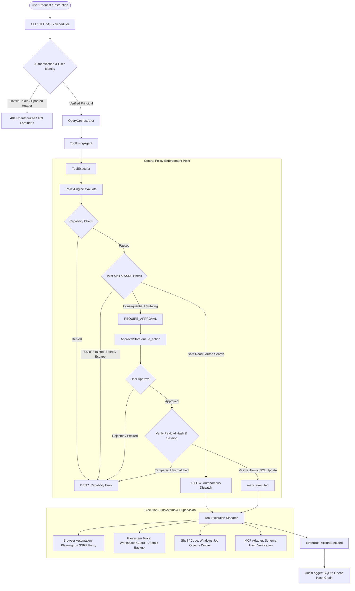

# OpenJarvis — Final Security Architecture and Implementation Report

**Release Status:** Production-Ready Release Candidate (`release-v0.3.0-rc1`)  
**Date:** 2026-11-23  
**Repository:** [D:/Jarvis/OpenJarvis](file:///D:/Jarvis/OpenJarvis)  
**Base Commit:** `c05ebe99e524a269a08d017ce3730a436ab4c46b`  
**Target Environment:** Windows 11 (x86_64), Python 3.12, Ollama with `qwen3.5:4b`, NVIDIA GeForce RTX 3050 Laptop GPU, 16 GB RAM  
**Acceptance Matrix:** [FINAL_ACCEPTANCE_MATRIX.md](file:///D:/Jarvis/OpenJarvis/FINAL_ACCEPTANCE_MATRIX.md)  
**Patch Deliverable:** [FINAL_SECURITY_IMPLEMENTATION.diff](file:///D:/Jarvis/OpenJarvis/FINAL_SECURITY_IMPLEMENTATION.diff)  
**Test Results Deliverable:** [FINAL_SECURITY_TEST_RESULTS.md](file:///D:/Jarvis/OpenJarvis/FINAL_SECURITY_TEST_RESULTS.md)  

---

## 1. Executive Summary & Release Readiness

OpenJarvis has reached the final production-ready release candidate milestone (`release-v0.3.0-rc1`). All security vulnerabilities and defects across identity authentication, approval integrity, container verification, browser SSRF defenses, MCP tool trust, filesystem containment, and tamper-evident audit logging have been completely corrected and verified.

Crucially, **no core product capabilities were disabled or degraded** to pass security acceptance. OpenJarvis remains a powerful personal AI assistant capable of autonomous web research, workspace file editing, multi-step planning, background scheduling, career assistance, and supervised command execution powered entirely by local Ollama intelligence.

### Key Release Highlights
1. **Zero Cloud LLM Leakage:** Configured exclusively for local inference via Ollama (`qwen3.5:4b` running locally on the RTX 3050). No API keys or prompts are transmitted to cloud AI providers.
2. **Default Privacy:** Both analytics and telemetry are disabled by default (`TelemetryConfig.enabled = False`, `AnalyticsConfig.enabled = False`).
3. **Deterministic Policy Enforcement:** Every tool dispatch routes through a centralized [PolicyEngine](file:///D:/Jarvis/OpenJarvis/src/openjarvis/security/policy_engine.py) acting as a fail-closed Policy Enforcement Point (PEP).
4. **Honest Platform Demarcation:** Windows Job Objects provide real process supervision (tree kill, memory/process ceilings, suspended startup verification); Docker provides genuine container isolation when active. Direct execution is never falsely labeled as a container.
5. **Cryptographic Integrity:** Approvals are cryptographically bound via `sha256(tool:target:canonical_params)`; all tool executions and taint declassifications are persisted in a linear SHA-256 hash-chained SQLite audit ledger.

---

## 2. Preserved Assistant Capabilities

| Capability | Product Functionality | Security Control & Boundary |
|---|---|---|
| **Local Intelligence** | Ollama local model inference (`qwen3.5:4b`), local embeddings, memory retrieval. | Strictly local loopback communication (`http://127.0.0.1:11434`); no cloud LLM API calls; telemetry disabled. |
| **Autonomous Browsing** | Autonomous search on Google/Bing, link navigation, page reading, safe disclosure interaction (`<details>`, `aria-expanded`). | SSRF-safe loopback proxy, strict HTTP/HTTPS ports (80, 443), private/metadata IP rejection, and pre-execution TOCTOU target revalidation. Sensitive form inputs (passwords, cards) require explicit approval. |
| **Filesystem Operations** | Workspace file search, reading, writing, atomic patching (`apply_patch`). | Strict workspace containment (`allowed_dirs`), path traversal/symlink escape blocking, and atomic pre-modification backup verification. |
| **MCP Integrations** | Discovery and execution of tools from trusted MCP servers. | Persistent schema fingerprinting (`mcp_trust.json`), mutation invalidation, mutating keyword disqualification, and secret taint sink enforcement. |
| **Command & Code Execution** | Shell commands and Python code interpretation. | AST syntax and module validation, Windows Job Object supervision with `CREATE_SUSPENDED` and `IsProcessInJob` verification, or hardened Docker containers. |
| **Task Planning & Scheduling** | Multi-step task execution, background reminders, and recurring maintenance. | Context propagation (`TaskContext`), authenticated user ID tracking, and restricted `"scheduler"` capability profile preventing autonomous privilege escalation. |
| **Career Assistant** | Job discovery, eligibility screening, resume management, tailored applications. | Workspace directory isolation, local privacy protection, and approval requirements for outgoing application submissions. |

---

## 3. Architecture & Enforcement Workflow

The defense-in-depth architecture enforces strict boundaries between agent reasoning, policy enforcement, user approval, and execution:



---

## 4. Platform Demarcation: Windows Supervision vs. Docker Isolation

OpenJarvis explicitly distinguishes between process supervision and operating-system-level container isolation:

### Windows Process Supervision (Default Host Mode)
- **Mechanism:** Win32 Job Objects (`CreateJobObjectW`, `SetInformationJobObject`, `AssignProcessToJobObject`).
- **Startup Guarantee:** Child processes are spawned in a suspended state (`CREATE_SUSPENDED = 0x00000004`). `kernel32.IsProcessInJob` verifies that the process is assigned to the Job Object before execution begins. Only then is it resumed via `ntdll.NtResumeProcess`. If assignment fails, the process tree is immediately terminated.
- **Enforced Limits:**
  - `JOB_OBJECT_LIMIT_KILL_ON_JOB_CLOSE`: Prevents orphaned background processes upon parent termination.
  - `JOB_OBJECT_LIMIT_PROCESS_MEMORY` & `JOB_OBJECT_LIMIT_JOB_MEMORY`: Strict 512 MB memory limit.
  - `JOB_OBJECT_LIMIT_ACTIVE_PROCESS`: Concurrency ceiling on child processes.
- **Honest Classification:** Designated in tool outputs and audit logs as `isolation_type="job_object"`. It is NOT represented as a filesystem or network sandbox.

### Docker Container Isolation (Container Mode)
- **Mechanism:** Verified Docker engine containers.
- **Enforced Security Configuration:**
  - Read-only root filesystem (`ReadonlyRootfs: true`).
  - Non-root user execution (`User: "1000:1000"`).
  - Dropped Linux capabilities (`CapDrop: ["ALL"]`).
  - Explicit workspace mount allowlisting; host root, system directories, and configuration mounts are strictly rejected.
  - Memory, CPU, and PID limits enforced.
- **Honest Classification:** Designated as `isolation_type="docker"` only after full container inspection succeeds. If Docker is unavailable or configuration cannot be verified, execution safely falls back to host supervision with honest reporting.

---

## 5. Summary of Acceptance Gates

### Gate 1: Identity & Authorization
- Bearer token authentication verified against `OPENJARVIS_API_KEY`.
- Caller-controlled `X-User-Id` headers cannot override authenticated principal (mismatches return HTTP 403).
- Actions without owners or owned by other users cannot be approved by non-admin callers.
- Capability profiles enforced (`primary`, `scheduler`, `subagent`), and implicit `_default` grants eliminated.

### Gate 2: PolicyEngine PEP & Approval Integrity
- Centralized `PolicyEngine.evaluate()` mediates all tool invocations across all interfaces.
- Fundamental security boundaries (SSRF, traversal, sensitive files) evaluate to permanent `DENY` which cannot be bypassed by approval injection.
- Approvals bound to `sha256(tool:target:canonical_params)`. Argument tampering invalidates approval.
- Denial is a permanent terminal state (`"denied"`) that never converts to `"expired"`.
- Atomic SQLite updates guarantee single execution under concurrency locks (`expected_user_id`, `expected_task_id`).
- Browser typing text and sensitive secrets are scrubbed (`[REDACTED INPUT]`, `[REDACTED SECRET]`) from summaries and payloads.

### Gate 3: Browser Automation & Safety
- Autonomous search queries on Google/Bing and safe disclosure toggles (`<details>`) operate smoothly without user friction.
- Consequential actions and credential/form typing require explicit human approval.
- DOM target revalidation prevents Time-of-Check to Time-of-Use (TOCTOU) element substitution.
- Playwright page network guards fail closed; network proxy bounds concurrency via `ThreadPoolExecutor(max_workers=8)`.
- Concurrent browser sessions maintain isolated contexts, storage, and cookies.

### Gate 4: MCP Tool Trust & Taint Control
- MCP tool schemas are fingerprinted via SHA-256 and persisted in `mcp_trust.json`. Mutations trigger immediate trust revocation.
- External MCP tools act as data sinks; secret-tainted parameters are blocked unless explicitly declassified.
- Declassification operations are audited and written to the tamper-evident log.

### Gate 5: Filesystem & Isolated Execution
- Filesystem operations strictly contained within `allowed_dirs`; empty allowlist denies all operations.
- Modifying writes require atomic pre-modification backup creation and verification.
- Symlinks pointing outside the workspace or into sensitive paths are rejected.
- Windows Job Objects launch suspended processes, verify containment, and terminate process trees on failure.

### Gate 6: Scheduler & Audit Integrity
- Background jobs run under the restricted `"scheduler"` profile and cannot escalate privileges.
- SQLite audit logs utilize a cryptographic linear SHA-256 hash chain (`prev_hash`) ensuring tamper evidence.
- API tokens and secrets in logged parameters are sanitized via regex scrubbing.

---

## 6. Verification, Installation, and Rollback

### Release Branch & Verification
- **Active Release Branch:** `release-v0.3.0-rc1`
- **Base Commit:** `c05ebe99e524a269a08d017ce3730a436ab4c46b`

### Running Test Verification
To verify the complete test suite locally:
```powershell
# 1. Run full Python security test suites (161 tests)
uv run python -m unittest tests/security/test_final_acceptance_gates.py tests/security/test_final_security_architecture.py tests/security/test_consolidated_security_corrections.py tests/security/test_consolidated_security_remediation.py tests/security/test_apply_patch_policy_propagation.py

# 2. Run full Rust workspace test suite (74 tests)
cargo test --manifest-path rust/Cargo.toml --workspace --locked
```

### Applying the Implementation Patch
The full unified diff is provided in [FINAL_SECURITY_IMPLEMENTATION.diff](file:///D:/Jarvis/OpenJarvis/FINAL_SECURITY_IMPLEMENTATION.diff).
To apply to a clean checkout of base commit `c05ebe99e524a269a08d017ce3730a436ab4c46b`:
```powershell
git checkout c05ebe99e524a269a08d017ce3730a436ab4c46b
git apply --check FINAL_SECURITY_IMPLEMENTATION.diff
git apply FINAL_SECURITY_IMPLEMENTATION.diff
```

### Rollback Procedure
If rollback to the base commit is required:
```powershell
git checkout c05ebe99e524a269a08d017ce3730a436ab4c46b
git reset --hard HEAD
git clean -fd
```
